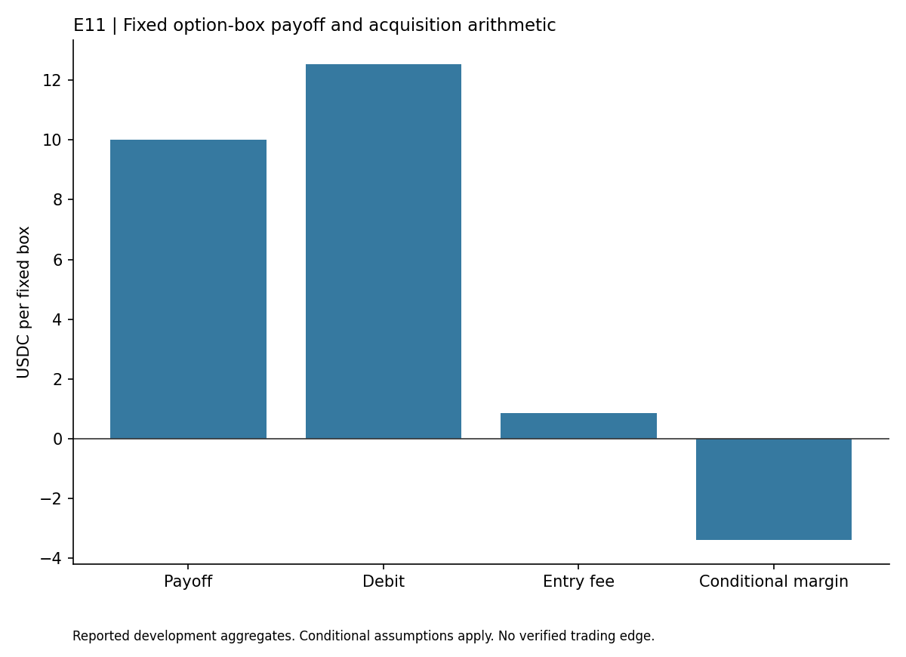

# Options Box Spreads

## Findings

This study checked one same expiry linear USDC option box. The fixed combination had a 10 USDC payoff and a 12.55 USDC acquisition debit. The margin was already -2.55 USDC before fees.

Adding the 0.84929 USDC entry fee scenario reduced the conditional margin to -3.39929 USDC. Delivery fees can reduce it further. The snapshot also failed the timestamp and execution checks.

This was a negative acquisition bound from a single snapshot, not a time series return study. The result supports no executable box trade and provides no evidence about every option expiry or strike combination.

## Reading this report

This public copy contains the findings of one completed development study. Its chart uses only the small aggregate table in [findings.json](findings.json). The original research history, raw observations, source datasets and reserved confirmation periods remain private. This copy does not reproduce a historical backtest or establish an independently confirmed strategy.

Install matplotlib in your own Python environment, then run `python plot_results.py` to regenerate the chart. The script reads the saved table and makes no network requests. These are reported findings from the original study, not a fresh evaluation. Passing an integrity check or reproducing this chart does not validate profitability.

The [public file manifest](PUBLIC_FILES.json) records hashes of the report, aggregate table, chart script and figure. This copy was prepared without the original Git history so personal commit email addresses are not exposed. It grants no rights to underlying third-party datasets.
